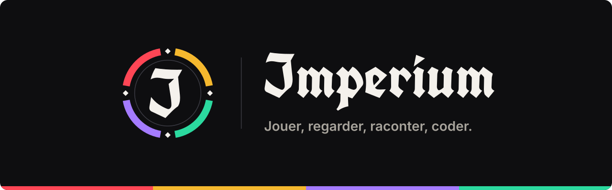

  <picture>
    <source media="(prefers-color-scheme: dark)" srcset="assets/banniere-sombre.svg">
    <source media="(prefers-color-scheme: light)" srcset="assets/banniere-clair.svg">
    
  </picture>

  <b>Quatre branches, un seul clan — et chacun peut en rejoindre plusieurs.</b>

---

## Les quatre branches

<table>
  <tr>
    <td align="center" width="96"></td>
    <td><b>ICG</b> · Imperium Clan Gaming Le jeu vidéo sous toutes ses formes : sessions, tournois, classements.</td>
  </tr>
  <tr>
    <td align="center"></td>
    <td><b>ICF</b> · Imperium Clan FanDom Films, séries et cultures de fans : projections, critiques, créations.</td>
  </tr>
  <tr>
    <td align="center"></td>
    <td><b>ICC</b> · Imperium Clan Communication La voix du clan : réseaux, visuels, annonces.</td>
  </tr>
  <tr>
    <td align="center"></td>
    <td><b>ICS</b> · Imperium Clan Software Le développement : bundles Symfony, outils et projets open source.</td>
  </tr>
</table>

## Un sceau par membre

Le sceau du clan compte quatre arcs, un par branche. Chaque membre allume les arcs de **toutes** ses branches : ici, un membre à la fois gamer (ICG), fan de cinéma (ICF) et développeur (ICS).

On ne choisit pas un camp : on rejoint l’Imperium.

 

## Imperium Clan Software

Développeurs indépendants spécialisés en **PHP** et **Symfony**, nous proposons une collection de bundles Symfony pour simplifier le développement d’applications.

**Nos dépôts :**
- [`conclave`](https://github.com/imperiumclansoftware/conclave)
- [`server`](https://github.com/imperiumclansoftware/server)
- [`tribubudget`](https://github.com/imperiumclansoftware/tribubudget)
- [`avenger`](https://github.com/imperiumclansoftware/avenger)
- [`lupa`](https://github.com/imperiumclansoftware/lupa)
- [`vscode-symfonybundlegenerator`](https://github.com/imperiumclansoftware/vscode-symfonybundlegenerator)
- [`ansible`](https://github.com/imperiumclansoftware/ansible)
- [`demo-angular`](https://github.com/imperiumclansoftware/demo-angular)
- [`Horloge-Oceane`](https://github.com/imperiumclansoftware/Horloge-Oceane)

 

